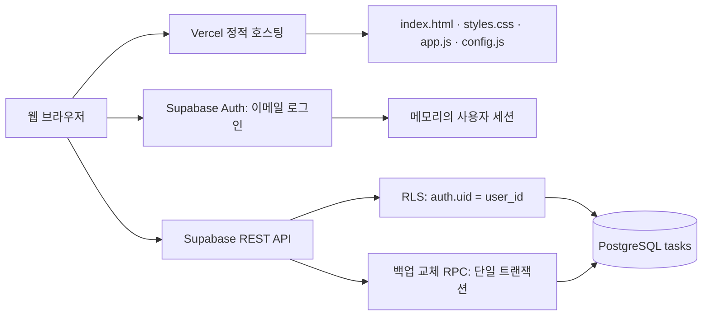

# 오늘의 보드 아키텍처

## 1. 구성

## 2. 파일 역할

| 파일 | 책임 |
|---|---|
| index.html | 로그인, 보드, 카드 편집 모달 구조 |
| styles.css | 원본 디자인과 반응형 스타일 |
| app.js | 로그인, 검색, 렌더링, 카드 CRUD, 드래그 이동, 백업 |
| config.js | 공개 Supabase URL 및 publishable/anon 키 |
| supabase.sql | 테이블, 인덱스, RLS 정책, 갱신 트리거, 백업 교체 RPC |
| vercel.json | 정적 배포와 기본 보안·캐시 헤더 |

## 3. 데이터 흐름

1. 이메일/비밀번호로 Supabase Auth에 로그인한다.
2. access token과 refresh token은 JavaScript 메모리에만 보관한다.
3. REST 요청의 Authorization에 access token을 전달한다. 토큰이 만료되기 전 다음 요청에서 갱신한다.
4. 조회·추가·수정·삭제는 PostgreSQL에 직접 반영된다. RLS가 로그인한 계정 소유 행만 허용한다.
5. 저장 성공 후 DB를 다시 조회해 화면을 갱신한다. 저장 실패 시 성공한 것처럼 화면을 바꾸지 않는다.
6. 저장은 성공했지만 재조회에 실패한 경우 확인이 필요하다는 별도 안내를 한다.

카드 데이터는 localStorage, sessionStorage, IndexedDB, 쿠키에 저장하지 않는다. 렌더링을 위한 현재 목록만 메모리에 둔다. 새로고침 시 로그인 상태도 사라져 다시 로그인해야 한다. 사용자가 명시적으로 내보낸 JSON 파일은 별도 백업이다.

## 4. 데이터 모델과 보안

`tasks`: user_id(uuid), id(text), title, description, status(todo/doing/done), priority(low/mid/high), due(date), created_at, updated_at.

- 복합 기본키 `(user_id, id)`로 원본 백업의 문자열 ID를 유지하면서 계정 간 충돌을 방지한다.
- user_id는 auth.users를 참조한다. 사용자 삭제 시 해당 카드도 삭제한다.
- 모든 CRUD에 RLS를 적용하고 비로그인 anon 역할의 테이블 권한을 제거한다.
- 공개 키는 브라우저에 노출되는 것이 정상이다. 보안 경계는 공개 키의 비밀성이 아니라 로그인 JWT와 RLS다.
- service_role 또는 secret 키는 프런트엔드에 넣지 않는다.
- 카드 문자열은 textContent로 렌더링해 HTML 삽입을 피한다.
- 백업 RPC는 SECURITY INVOKER로 호출자의 권한/RLS를 유지한다. DELETE와 INSERT를 한 트랜잭션으로 실행하여 실패 시 기존 카드를 복원한다.

## 5. 동시성·제약

- 실시간 구독 기능은 포함하지 않는다. 다른 탭/기기의 변경은 새로고침 버튼으로 조회한다.
- 일반 수정은 마지막으로 저장된 필드 값이 우선한다. updated_at은 기록하지만 충돌 감지는 구현하지 않았다.
- 백업 교체끼리는 계정별 잠금을 사용한다. 일반 CRUD와 백업 교체의 동시 실행까지 완전히 직렬화하지는 않으므로 가져오기 중에는 다른 기기에서 편집하지 않는다.
- 열 사이 드래그는 상태를 변경하며, 열 안의 수동 정렬은 제공하지 않는다.
- 네트워크가 끊기면 저장할 수 없으며 오프라인 저장/재시도 큐는 없다.
- 공동 보드가 아닌 계정별 개인 보드다. 협업은 별도 boards/members 모델과 정책이 필요하다.
- 비밀번호 재설정 UI, MFA, 실시간 동기화는 별도 확장 항목이다.

## 6. 배포 구조

Vercel은 정적 파일만 서비스하며 카드 DB를 보관하지 않는다. 브라우저에서 HTTPS로 Supabase와 통신한다. config.js는 공개 설정 파일이며 Vercel 환경변수 자동 주입을 전제로 하지 않는다. 실제 서비스의 Supabase 프로젝트 생성, SQL 실행, 설정값 입력 및 Vercel 재배포는 README 절차를 따른다.
